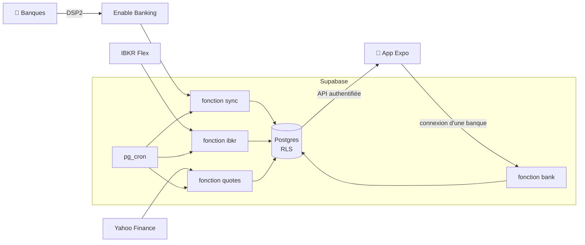

<div align="center">


# SelfFinance

**Tous mes comptes, au même endroit.**
Une app perso Android qui regroupe comptes bancaires, épargne et placements, avec les plus-values, grâce à l'Open Banking.


**[📘 Installer ta propre copie → docs/SETUP.md](docs/SETUP.md)**

</div>

---

## ✨ Ce que fait l'app

| | Écran | Description |
|---|---|---|
| 🏦 | **Comptes** | Tous les comptes bancaires, leur solde et le total. Bouton de synchro, réglages des synchros automatiques, ajout et reconnexion des banques. |
| 📄 | **Détail d'un compte** | Les opérations jour par jour, l'état de l'accès bancaire, et un solde saisi à la main si la banque n'en donne pas. |
| 🥧 | **Patrimoine** | Total général (banques + épargne + placements) et plus-value globale. Livrets, PEA, CTO, assurance-vie, PER, épargne salariale, IBKR. |
| 🔀 | **Transactions** | Toutes les banques mélangées, mois par mois, avec un filtre par banque. Les dépenses sont totalisées **hors virements internes**. |

Les virements entre mes propres comptes (SG → IBKR, SG → Revolut…) sont détectés et grisés : le même argent n'est jamais compté deux fois.

## 🔌 Sources de données

| Source | Méthode | Mise à jour |
|---|---|---|
| Comptes courants (SG, Revolut, BNP…) | Open Banking via **Enable Banking** | Auto aux heures choisies (max 4 accès/jour, limite DSP2) + bouton |
| IBKR | API officielle **Flex Web Service** (lecture seule) | Auto chaque jour à 7 h + bouton |
| Actions et ETF (PEA, CTO…) | Positions saisies (quantité + PRU), cours **Yahoo Finance** | Auto chaque jour ouvré à 19 h |
| Fonds d'épargne salariale (FCPE) | Positions saisies, valeur de part à la main | Manuelle |
| Livret A, LDDS, fonds euros… | Solde ou valeur saisis | Manuelle |

> L'Open Banking (DSP2) ne couvre que les **comptes de paiement** : l'épargne et l'investissement passent par d'autres moyens. Détails et décisions dans [`docs/open-banking.md`](docs/open-banking.md).

## 🧭 Architecture



- La **clé privée Enable Banking et tous les secrets restent sur le serveur** (Vault + secrets de fonctions), jamais dans le téléphone.
- L'app ne parle qu'à Supabase, avec le compte du propriétaire ; chaque table est protégée par des règles d'accès (RLS).
- Les tâches automatiques tournent dans la base (`pg_cron`), même quand le téléphone et le PC sont éteints.

## 🚀 Installer

Tout est expliqué pas à pas dans **[docs/SETUP.md](docs/SETUP.md)** : Supabase, Enable Banking, secrets, app sur le téléphone, connexion des banques, Patrimoine, IBKR, APK et dépannage. Chacun installe **sa propre copie** : aucune donnée n'est partagée.

## 🗺️ Feuille de route

- [x] Open Banking validé en sandbox, puis en production (SG, Revolut, BNP)
- [x] App Expo + backend Supabase
- [x] Synchro automatique côté serveur (heures réglables, bouton manuel, budget DSP2)
- [x] Écrans : comptes, détail, transactions globales
- [x] Détection des virements internes
- [x] Connexion et reconnexion des banques depuis l'app
- [x] Patrimoine : comptes manuels, positions, cours, plus-values, € ou $
- [x] IBKR via le Flex Web Service
- [ ] Historique des opérations (achats, ventes, dividendes)
- [ ] Catégorisation des dépenses, abonnements, budgets
- [ ] Version iPhone

## 📁 Structure

```
selffinance/
├── app/                      app Expo (Expo Router)
│   ├── src/app/              écrans : (tabs)/, account/, patrimoine/, settings, add-bank…
│   ├── src/lib/              accès aux données, calculs, formatage
│   └── tests/                tests unitaires (npm test)
├── supabase/
│   ├── migrations/           schéma, sécurité, tâches automatiques
│   ├── functions/            sync · bank · quotes · ibkr
│   ├── setup/                modèle des secrets (secrets.example.sql)
│   └── tests/                vérifications SQL
├── docs/
│   ├── SETUP.md              guide d'installation complet
│   ├── open-banking.md       recherche, couverture des banques, décisions
│   └── superpowers/          conception et plans
└── scripts/eb.ps1            client Enable Banking en ligne de commande (tests, facultatif)
```

## 🧪 Tests

```bash
cd app && npm test                         # calculs et formatage
node --test supabase/functions/ibkr/       # lecture des relevés IBKR
```

Les fichiers de `supabase/tests/` se lancent dans le SQL Editor de Supabase : ils annulent tout ce qu'ils créent et renvoient `OK`.

## 🔒 Sécurité

- Exclus de git : clés (`*.pem`), `.env*`, sessions bancaires, `supabase/setup/secrets.sql`, `supabase/private/`, exports de données.
- Accès aux banques et à IBKR en **lecture seule**.
- Seul le **premier compte créé** (le propriétaire) a accès aux données.
- Les accès bancaires expirent au bout de 90 à 180 jours selon la banque ; l'app prévient 15 jours avant.
