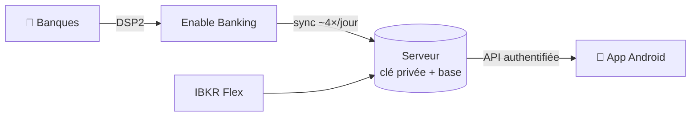

<div align="center">


# SelfFinance

**Tous mes comptes, au même endroit.**
Une app perso (Android d'abord) qui regroupe soldes et transactions de toutes mes banques grâce à l'Open Banking.


</div>

---

## ✨ Ce que fera l'app

| | Écran | Description |
|---|---|---|
| 🏦 | **Mes comptes** | Tous les comptes avec leur solde et le total global. |
| 📄 | **Détail d'un compte** | Les transactions d'un compte, jour par jour. |
| 🔀 | **Transactions globales** | Toutes les banques mélangées, avec un filtre par banque. Les dépenses sont totalisées **hors virements internes**. |

Les virements entre mes propres comptes (SG → IBKR, SG → Revolut…) sont détectés et grisés. Comme ça, le même argent n'est pas compté deux fois.

## 🔌 Sources de données

| Source | Méthode | Statut |
|---|---|---|
| Société Générale | Open Banking (Enable Banking) | ✅ Connectée |
| Revolut | Open Banking (Enable Banking) | ✅ Connectée |
| BNP Paribas | Open Banking (Enable Banking) | ✅ Connectée |
| Fortuneo | Open Banking (Enable Banking) | 🟡 Disponible, à connecter |
| Trade Republic (espèces) | Open Banking (Enable Banking) | 🟡 Disponible, à connecter (sans libellés) |
| IBKR | API officielle (Flex Web Service) | 🔜 Prévu |
| PEA / CTO Fortuneo, Trade Republic, Revolut | Saisie des positions + cours automatiques | 🔜 Prévu |
| Natixis Interépargne | Saisie des parts + VL (base AMF) | 🔜 Prévu |
| Livret A, poches Revolut | Saisie manuelle | 🔜 Prévu |

> L'Open Banking (DSP2) ne couvre que les **comptes de paiement**. L'épargne et l'investissement passent donc par d'autres moyens. Tous les détails sont dans [`docs/open-banking.md`](docs/open-banking.md).

## 🧭 Architecture visée



La **clé privée Enable Banking reste sur le serveur**, jamais dans le téléphone. L'app ne parle qu'au serveur.

## 🚀 Tester la récupération (script PowerShell)

Le prototype actuel est un script autonome pour Windows (PowerShell 5.1). La signature JWT passe par l'`openssl` fourni avec Git for Windows.

```powershell
$env:EB_APP_ID   = "<UUID de l'app Enable Banking>"
$env:EB_KEY_PATH = "C:\chemin\vers\cle.pem"

.\scripts\eb.ps1 check                               # mes banques sont-elles disponibles ?
.\scripts\eb.ps1 list -Country FR                    # toutes les banques d'un pays
.\scripts\eb.ps1 auth -Bank "BNP Paribas"            # lien de connexion à la banque
.\scripts\eb.ps1 session -Code "<URL localhost>"     # enregistre la session
.\scripts\eb.ps1 tx -Days 30                         # soldes + transactions
```

Après la connexion à la banque, le navigateur affiche une erreur `localhost` : **c'est normal**. Il suffit de copier l'URL (celle qui contient `code=`) et de la passer à `session`.

## 🗺️ Feuille de route

- [x] Valider l'Open Banking en sandbox
- [x] App Enable Banking en production + SG, Revolut, BNP connectées
- [ ] Connecter Fortuneo et Trade Republic
- [ ] Choisir la stack de l'app (Expo ou web app) + backend (Supabase)
- [ ] Synchro automatique côté serveur
- [ ] Écrans : comptes, détail, transactions globales
- [ ] Détection des virements internes
- [ ] IBKR via le Flex Web Service
- [ ] Saisie manuelle : PEA/CTO, Natixis, Livret A
- [ ] Catégorisation des dépenses, abonnements, budgets

## 📁 Structure

```
selffinance/
├── assets/            icône
├── docs/
│   └── open-banking.md   recherche, couverture des banques, décisions
└── scripts/
    └── eb.ps1            client Enable Banking (test)
```

## 🔒 Sécurité

- Les sessions bancaires (`scripts/sessions*.json`), les clés (`*.pem`) et le fichier `.env` sont **exclus de git**.
- L'accès aux banques est en **lecture seule**.
- Les consentements expirent au bout de 90 à 180 jours, selon la banque.
