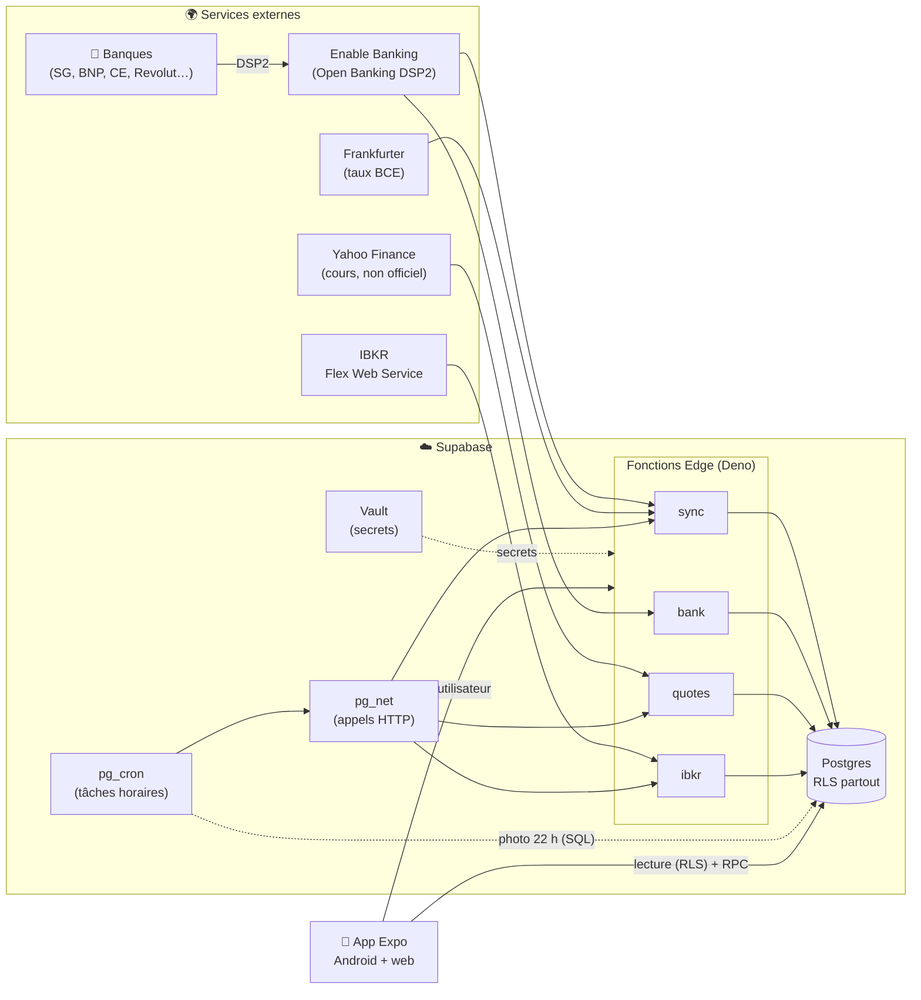
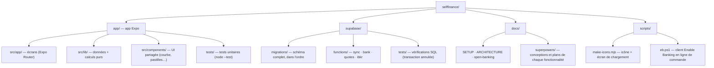
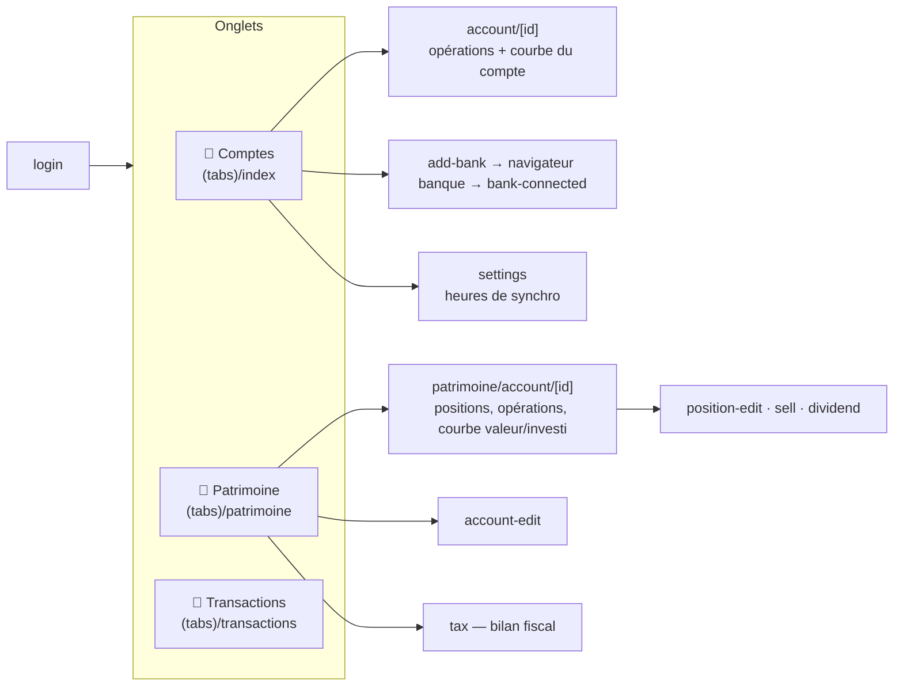
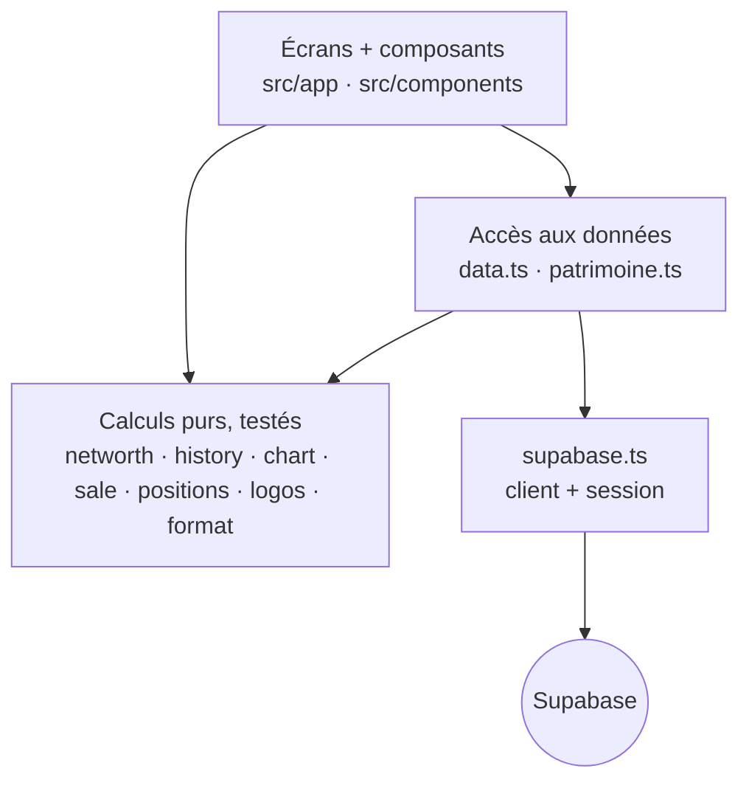
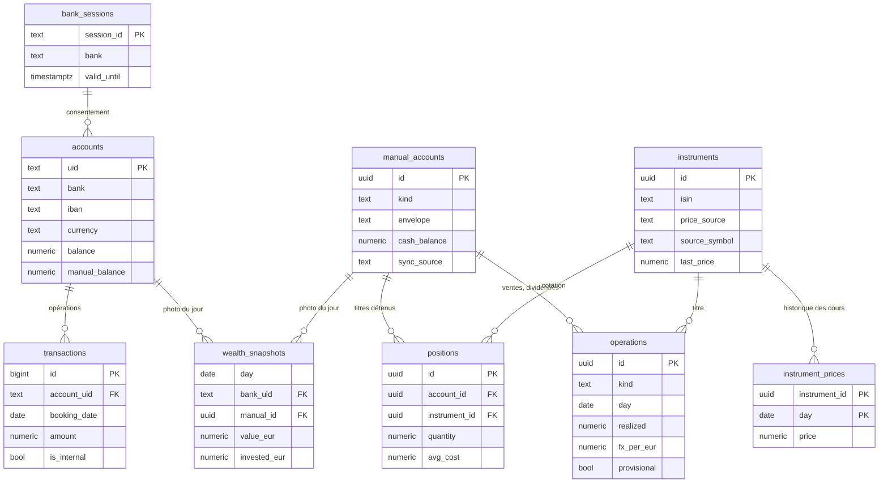
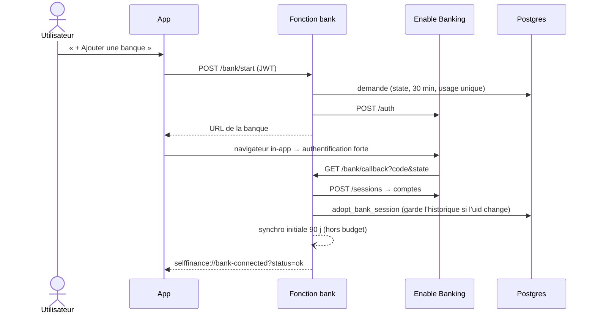
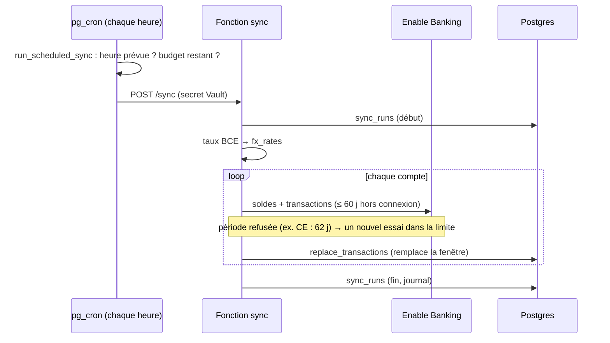
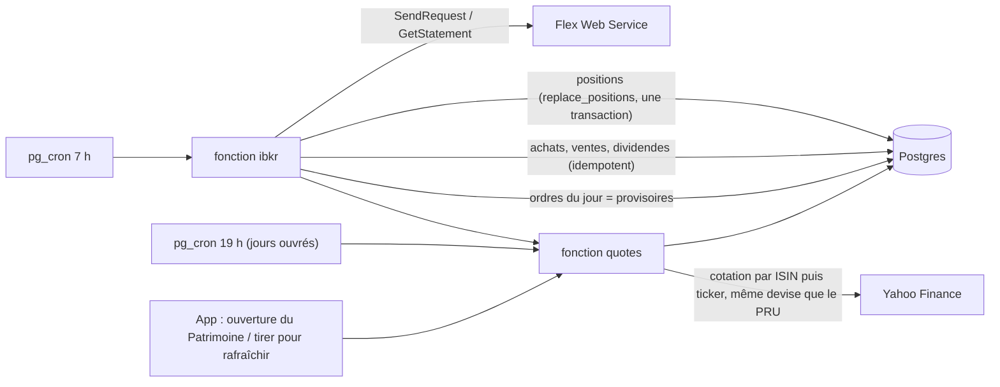
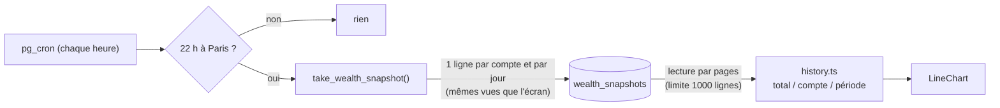
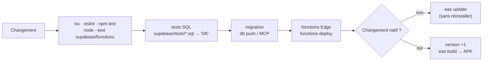

# 🧭 Architecture de SelfFinance

Ce document explique **comment l'app est construite** : les briques, les flux de données, le modèle
de données, la sécurité et la façon dont on teste et livre. Pour installer ta propre copie, voir
[`SETUP.md`](SETUP.md) ; pour les choix liés à l'Open Banking, [`open-banking.md`](open-banking.md).

> Principe directeur : **une personne = une copie**. Pas de multi-utilisateurs, pas de serveur à
> maintenir : une app Expo + un projet Supabase (Postgres, fonctions Edge, tâches planifiées, coffre à secrets).

---

## 1. Vue d'ensemble

| Brique | Rôle |
|---|---|
| **App Expo** (`app/`) | Interface (Expo Router, TypeScript). Lit la base directement (règles RLS) et appelle les fonctions Edge pour tout ce qui touche l'extérieur. |
| **Postgres** (`supabase/migrations/`) | Données, vues de calcul (soldes en €, plus-values), fonctions SQL (ventes, bilan fiscal, photo du patrimoine). |
| **Fonctions Edge** (`supabase/functions/`) | Seul endroit qui parle aux services externes, avec les secrets. |
| **pg_cron + pg_net** | Déclenchent les synchros aux heures prévues (heure de Paris, été comme hiver). |
| **Vault** | Secrets (URL du projet, secret des tâches planifiées, ID Enable Banking, jeton IBKR). La clé privée Enable Banking est un secret de fonction. |

---

## 2. Organisation du dépôt

---

## 3. L'app

### Écrans

### Couches de code

- **Calculs purs** : aucune dépendance à Supabase ni à React Native, donc testables avec `node --test`
  (`app/tests/`). Exemples : total du patrimoine, séries de la courbe, géométrie SVG, aperçu d'une vente,
  correspondance banque → logo.
- **`useLoad`** (`data.ts`) : charge un écran, recharge au retour sur l'écran et au « tirer pour rafraîchir »,
  et ignore les réponses arrivées trop tard (changement de mois rapide).
- **Courbe** : `LineChart` (react-native-svg) dessine ce que `chart.ts` calcule ; toucher → point le plus proche.
- **Logos des banques** : liste officielle d'Enable Banking chargée une fois, partagée par toutes les pastilles ;
  à défaut, pastille à initiales.

---

## 4. Modèle de données

Tables de service : `app_users` (le propriétaire), `fx_rates` (1 EUR = x devise), `internal_rules`
(détection des virements internes), `sync_runs` + `sync_settings` (journal et heures des synchros),
`bank_auth_requests` (connexions en cours), `tax_settings` (taux, moins-values reportées).

**Vues de calcul** (lues par l'app, `security_invoker`) : `account_view`, `transaction_view`
(montants en €), `position_view`, `manual_account_view` (valeur, investi, plus-value),
`operation_view`. Règle : **un taux de change manquant donne `null`, jamais un repli à 1**.

---

## 5. Les flux principaux

### Connexion d'une banque

### Synchronisation bancaire (budget DSP2 : 4 accès / jour)

Le bouton « Synchroniser » de l'app suit le même chemin avec le JWT de l'utilisateur, dans la limite
du budget du jour (`sync_budget()`).

### IBKR et cours des titres

### Historique du patrimoine (la courbe)

---

## 6. Tâches planifiées

| Tâche | Fréquence | Agit si… | Fait |
|---|---|---|---|
| `sync-banks` | chaque heure | l'heure fait partie des heures choisies et le budget le permet | appelle `sync` |
| `sync-ibkr` | chaque heure | il est 7 h et la Flex Query est configurée | appelle `ibkr` |
| `refresh-quotes` | chaque heure | il est 19 h un jour ouvré | appelle `quotes/refresh` |
| `wealth-snapshot` | chaque heure | il est 22 h | photo du patrimoine en SQL (aucun accès bancaire) |

Toutes comparent l'heure **de Paris** : pas de décalage au changement d'heure.

---

## 7. Sécurité

- **RLS sur toutes les tables** : lecture réservée à `is_app_user()` (le premier compte créé) ;
  l'app n'écrit que ce qui est saisi à la main (solde manuel, comptes, positions, opérations manuelles).
- **Fonctions Edge** : `verify_jwt = false` mais authentification faite par chaque fonction
  (JWT d'un `app_user`, ou secret Vault pour les tâches planifiées ; jamais accepté si le secret est absent).
- **Secrets** : jamais dans le dépôt (`.gitignore` : `*.pem`, `.env*`, `secrets.sql`…). Clé Enable Banking
  côté serveur uniquement ; l'app ne contient que l'URL Supabase et la clé *publishable*.
- **Lecture seule** : aucun accès bancaire ou IBKR ne peut initier de paiement ni d'ordre.
- **Connexion bancaire** : `state` à usage unique (30 min), adresse de retour limitée au schéma de l'app.
- Fonctions SQL sensibles (`sync_config`, `ibkr_token`, `take_wealth_snapshot`, `replace_positions`…) :
  exécutables par `service_role` seulement.

---

## 8. Tests et livraison

| Niveau | Où | Lancer |
|---|---|---|
| Calculs de l'app | `app/tests/*.test.ts` | `cd app && npm test` |
| Logique des fonctions | `supabase/functions/**/*.test.ts` | `node --test supabase/functions/` |
| Base de données | `supabase/tests/*.sql` | SQL Editor ou MCP : chaque fichier renvoie `OK` |
| Types et style | — | `npx tsc --noEmit && npx eslint src tests` |

Le numéro de version de l'app (`app.json`) sert aussi de « runtime » pour les mises à jour sans
réinstallation : un module natif ajouté ⇒ nouvelle version ⇒ nouvel APK.

---

## 9. Choix importants

| Choix | Pourquoi |
|---|---|
| Enable Banking plutôt qu'un agrégateur payant | Offre perso gratuite, DSP2 officiel ; contrainte : comptes liés dans le Control Panel. |
| Budget de 4 accès/jour calculé en base | Limite DSP2 sans l'utilisateur ; la synchro de connexion n'est pas comptée. |
| Fenêtre de synchro ≤ 60 jours | Certaines banques (Caisse d'Épargne) refusent au-delà de 62 jours hors connexion. |
| Plus-values au PRU moyen (règle française) | IBKR calcule en FIFO : le bilan fiscal reste une estimation. |
| Courbe faite maison (react-native-svg) | Un seul module natif, thème clair/sombre, calculs testés. |
| Logos officiels Enable Banking | Pas d'imitation de marques ; pastille de secours si absent. |
| Une ligne par compte et par jour pour l'historique | Total, détail par compte et futures vues (par catégorie) avec les mêmes données. |
